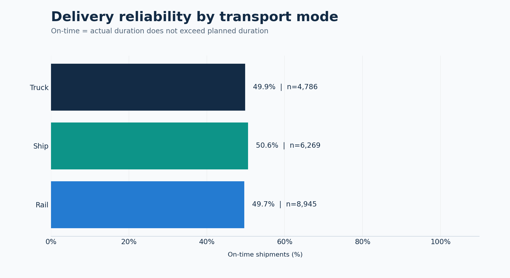
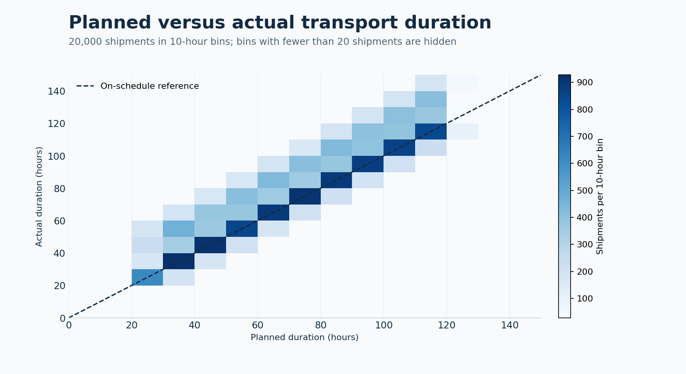
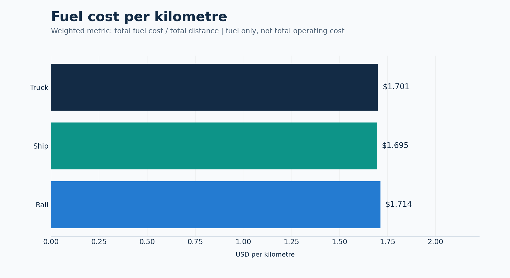
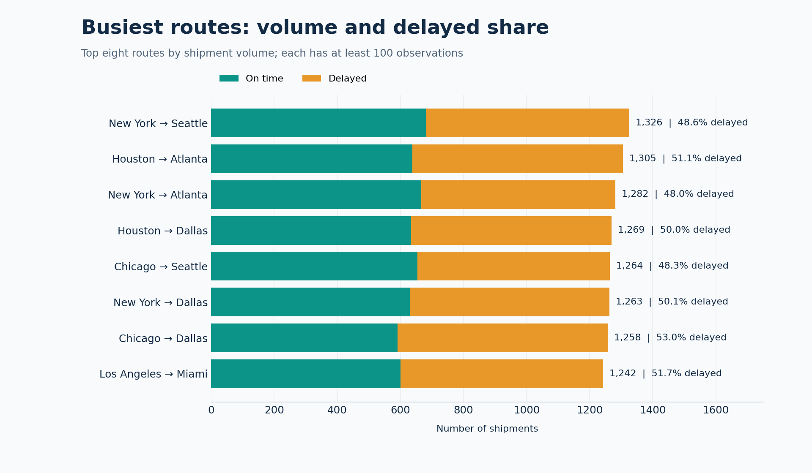

# Intermodal Logistics Analytics

I became interested in logistics because it connects data with practical decisions about routes, delivery times and transport costs. I wanted to explore how shipment data could help identify delivery delays and compare fuel efficiency across different routes and transport modes. This project follows that idea from data validation to analysis, using Python and PostgreSQL to produce clear metrics and visualizations that make the results easy to understand.


[](https://github.com/gusbakers/intermodal-data-platform/actions/workflows/ci.yml)


## Snapshot results

These values are computed from the repository's **20,000 shipment records**. They describe the included dataset, not a measured improvement in a company's operations.

| Metric | Observed result |
|---|---:|
| Accepted shipments | 20,000 |
| Rejected shipment records | 0 |
| Observed dominant modes | Rail, Ship, Truck |
| On-time delivery | 50.00% |
| Average planned duration | 72.04 hours |
| Average actual duration | 79.56 hours |
| Average delay among delayed shipments | 17.01 hours |
| Average fuel expense per shipment | $6,518.88 |
| Weighted fuel expense per kilometre | $1.705 |

The exact values are saved in [metrics.json](outputs/metrics.json); six downloadable tables are in [outputs/tables](outputs/tables). Definitions and denominators are documented in [DATA_DICTIONARY.md](docs/DATA_DICTIONARY.md).

## Operational view

**Delivery reliability.** Compare each mode's on-time rate and shipment count.



**Duration overruns.** The chart groups all shipments into ten-hour bins. Areas above the reference line represent durations longer than planned; bins with fewer than 20 shipments are hidden. KPI calculations use all accepted records.



**Fuel efficiency.** The measure is total fuel expense divided by total distance. It covers fuel expense, not total operating cost.



**Route review.** The busiest routes are shown with their delayed share; each displayed route has at least 100 shipments.



These comparisons help identify where to investigate planning and shipment mix. They do not establish the causes of delays, guaranteed savings or route profitability.

## What the pipeline does

1. Reads the included CSV, independent of the current working directory.
2. Validates all 18 required fields, numeric ranges, integer fields, categorical values, unique shipment IDs and status/duration consistency.
3. Quarantines rejected rows with their source row and failure reasons. The default quality gate permits **zero rejected records**.
4. Computes duration overruns and fuel-cost ratios, and atomically publishes a Parquet file.
5. Generates six KPI tables, four PNG charts and a JSON run manifest with input checksum, row counts and elapsed time.
6. With `--with-database`, upserts dimensions and shipment facts into PostgreSQL and refreshes six materialized views in one transaction.

An unchanged repeat database load does not add fact rows or update their load timestamps. Changed shipment records are updated by `shipment_id`; records absent from a later input are retained. This is an upsert workflow, not a full-table replacement.

## Run without a database

From a terminal in a local environment or GitHub Codespaces with Python 3.11 or 3.12:

```bash
git clone https://github.com/gusbakers/intermodal-data-platform.git
cd intermodal-data-platform
python -m venv .venv
source .venv/bin/activate
python -m pip install -r requirements.txt
python run_full_pipeline.py
```

On Windows PowerShell, activate with `.venv\Scripts\Activate.ps1`.

This generates `data/processed/shipments_processed.parquet`, a quarantine CSV under `data/rejected/`, and the analytical files under `outputs/`. `outputs/run_summary.json` records the actual run duration and explicitly says whether the database phase was loaded or skipped. Runtime files and local credentials are ignored by Git.

## Run with PostgreSQL

Docker with Compose provides a local PostgreSQL 16 database; no cloud account is required. After installing the Python dependencies:

```bash
cp .env.example .env
```

Open `.env` and set `DB_PASSWORD` to a local password of your choice. Keep this file out of Git. Then run:

```bash
docker compose up -d --wait
python run_full_pipeline.py --with-database
python run_full_pipeline.py --with-database
```

For an unchanged dataset and an initially empty database, the second manifest should report `stored_shipments: 20000` and `changed_records: 0`. The schema is created automatically in the `logistics` namespace.

Query an analytical view:

```bash
docker compose exec postgres sh -c 'psql -U "$POSTGRES_USER" -d "$POSTGRES_DB" -c "SELECT * FROM logistics.mv_kpi_dashboard;"'
```

Stop PostgreSQL when finished; this preserves its local data volume:

```bash
docker compose down
```

The six materialized views cover the overall dashboard, modes, routes, cargo types, priorities and fuel efficiency. [business_kpis.sql](sql/kpis/business_kpis.sql) contains ready-to-run analytical queries. [ARCHITECTURE.md](docs/ARCHITECTURE.md) explains transaction boundaries and the shipment grain.

## Quality and testing

```bash
python -m pip install -r requirements-dev.txt
python -m ruff check .
python -m ruff format --check .
python scripts/verify_project.py
python -m pytest -m 'not integration' --cov=src --cov-report=term-missing
python scripts/execute_notebooks.py
```

Tests exercise missing files and columns, invalid values, conflicting IDs, status consistency, Parquet round trips, quality-gate failures and weighted KPI calculations. The quality report lists checked and failed records for each rule; it does not invent an overall quality score.

PostgreSQL integration tests additionally check repeat loads, changed records, agreement between all six SQL views and Python KPIs, and transaction rollback. They run in GitHub Actions against a disposable PostgreSQL 16 service. To run them yourself, set `TEST_DATABASE_URL` to a **dedicated disposable database** before `python -m pytest -m integration`; these tests reset its `logistics` schema.

The workflow tests Python 3.11 and 3.12, regenerates the outputs and executes all three notebooks. The notebooks include saved outputs and short explanations:

- [Data exploration](notebooks/01_data_exploration.ipynb)
- [Data quality report](notebooks/02_data_quality_report.ipynb)
- [Executive KPI dashboard](notebooks/03_kpi_dashboard.ipynb)

## Repository structure

| Location | Purpose |
|---|---|
| `src/etl/` | Extraction, validation, transformation, Parquet and PostgreSQL loads |
| `src/analytics.py` | Shared metric definitions and six Python KPI tables |
| `src/visualization.py` | Four charts generated from validated records |
| `sql/schema/` | Four dimensions, shipment fact table and analytical views |
| `tests/` | Behavioral and PostgreSQL integration checks |
| `notebooks/` | Executed analysis, quality and executive reporting |
| `outputs/` | Versioned metrics, quality results, KPI tables and charts |
| `config/`, `.env.example` | Portable paths and documented environment settings |

## Data scope

The CSV was already present in this repository. Its original upstream provider, collection dates and generation process are not documented; the analysis makes no claim that it represents a production transport network.

It contains shipment-level durations and a dominant transport mode, but no shipment dates, carrier identities, revenue or leg-level sequence. Monthly trends, carrier scorecards, complete intermodal movement reconstruction and profitability calculations require additional source fields. The schema and dashboard intentionally reflect the available data.

Future extensions include scheduled orchestration and additional source events. A delay-prediction model would first need a feature-availability review to prevent post-arrival measurements from leaking the outcome.

## Connect

Gustavo · Master's in Data Science  
Data Engineering · Machine Learning · AI Systems  
[GitHub profile](https://github.com/gusbakers)
