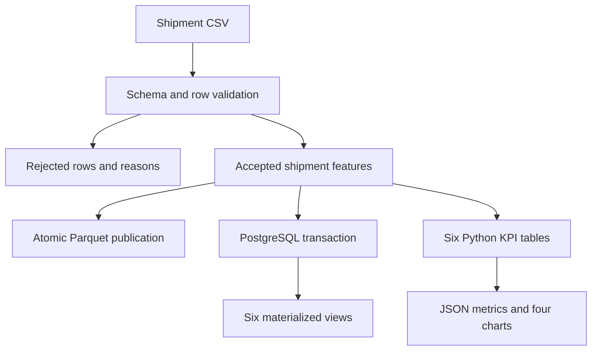

# Architecture

The platform processes a shipment snapshot into a validated file layer and a PostgreSQL analytical model. A single CLI coordinates the stages, with a database phase enabled by `--with-database`.

## Processing boundary

Paths resolve against the checkout rather than the process working directory. Configuration and logging do not create files on module import. The CLI loads local `.env` values; database passwords have no source-code default.

Validation requires all 18 source columns before checking row rules. Rejected rows retain their input values, source row numbers and explicit reason codes. Identical duplicate rows retain one accepted record; all conflicting records sharing a shipment ID are rejected. The zero-rejection default stops publication when any rows fail.

Processed Parquet is written to a temporary file and atomically renamed. KPI tables, quality JSON and figures are reproducible analysis outputs. A success manifest is published after all requested phases finish; a failed run removes the previous success manifest. Local analytical files may already exist if the later database phase fails, so inspect the manifest before treating a run as successful.

## Database grain and transaction

`logistics.fact_shipments` has a primary key on `shipment_id`. Four dimensions hold transport modes, origin/destination routes, cargo types and priority levels. The model uses only available source attributes.

A load acquires a transaction-scoped application advisory lock, creates missing schema objects, upserts dimensions and facts, then refreshes all six materialized views. An error rolls the entire database transaction back. View refreshes use regular `REFRESH MATERIALIZED VIEW`; this small batch workflow may temporarily block readers during refresh.

Source content is hashed using SHA-256. An unchanged shipment does not update its `loaded_at`; a changed shipment updates the existing row. Removed source rows remain in the database. This provides idempotent upserts, not snapshot synchronization or CDC.

The joined view exposes shipment features. Materialized views cover dashboard, mode, route, cargo, priority and fuel summaries. Foreign-key indexes support joins; performance improvements must be measured rather than assumed.

## Verification

Behavioral tests cover the file pipeline and quality gate. PostgreSQL integration tests use a disposable database to check repeat loads, updates, all-six-view metric parity and rollback. GitHub Actions additionally loads the complete dataset twice and checks that the second load has 20,000 retained facts and zero changed records.
